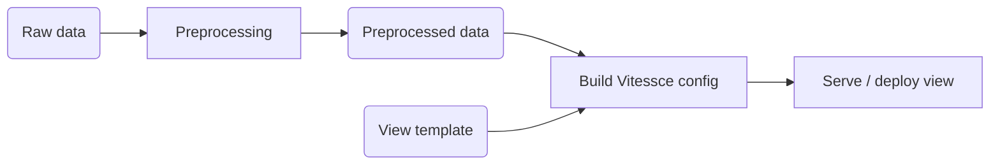

<p align="center">
  
</p>

<h1 align="center">
  CellXPatient
</h1>
<p align="center">
</p>

[](https://github.com/sdsc-ordes/cellxpatient/releases/latest)
[](https://github.com/sdsc-ordes/cellxpatient/actions/workflows/normal.yaml)
[](http://www.apache.org/licenses/LICENSE-2.0.html)

**Authors:**

- [Almut Lütge](mailto:almut.luetge@sdsc.ethz.ch)
- [Giliane Rochat](mailto:giliane.rochat@epfl.ch)

## Description

CellXPatient is a project that aims to provide a visualisation platform for
single-cell and spatial transcriptomics data in clinical context.

After evaluating several open-source alternatives (see the documentation
(`docs/tool_evaluation`)), the project uses Vitessce to build the visualisation
platform. This repository contains cellxpatient, a small Python package that
turns preprocessed single-cell and spatial datasets into configured Vitessce
views and serves them on a web portal.

The state of the repository that contains the code of all evaluated tools is
archived at the git tag `before-multitool-cleanup`.

## How cellxpatient works



1. **Preprocess** converts a dataset (AnnData or Xenium) into a Vitessce-ready
   zarr store. Eventually this step will happen completely upstream this
   package. For now, there are still remaining reformatting steps necessary.
2. **Build** generates a Vitessce view configuration from a human-readable YAML
   template (see the [documentation](docs/view-templates.md) about the view
   template).
3. **Serve** starts a web server that hosts the frontend, the processed data and
   the view config, so no separate data server is needed. The frontend in
   [frontend/](frontend) is a React app that embeds Vitessce and adds custom
   views, such as the Group Builder for comparing two groups of samples.

## Installation

There are two main ways to install the package: with or without Nix. For
development we recommend installing and using
[Nix](https://nix.dev/install-nix.html).

### With Nix (recommended)

Follow the [instructions](https://nix.dev/install-nix.html) to install `Nix`.

The project uses the `flakes` experimental features. It must be enabled by
adding `experimental-features = nix-command flakes` to your nix.conf (either at
`~/.config/nix/nix.conf` or `/etc/nix/nix.conf`)

The development shells defined in `tools/nix` provide all tools for development.
`Direnv` makes it convenient to automatically load the default shell with
necessary environment when entering the repository (see
[direnv documentation](https://direnv.net)). To make it available for your nix
profile, run from the repository root:

```bash
nix profile install --accept-flake-config ./tools/nix#bootstrap
```

Add the direnv's hook to your shell startup file:

```bash
echo 'eval "$(direnv hook bash)"' >> ~/.bashrc
source ~/.bashrc

# Or for zsh
echo 'eval "$(direnv hook zsh)"' >> ~/.zshrc
source ~/.zshrc
```

And finally, run from the project root ( this is only needed once):

```bash
direnv allow
```

Then, build the frontend:

```bash
just install-frontend
```

See [Usage](#usage) for a description of the just recipes to run nix and other
commands.

### Without Nix

The python environment can be manually set up using `uv`, which locks
dependencies for reproducibility (see
[uv installation](https://docs.astral.sh/uv/getting-started/installation/)).
With `uv` installed, run:

```bash
uv sync
source .venv/bin/activate
```

We recommend installing Node.js and npm using
[nvm](https://github.com/nvm-sh/nvm) as it allows to install Node.js specific
versions per shell. To verify nvm is installed:

```bash
command -v nvm            # should return "nvm"
```

The file `.nvmrc` specifies the Node.js version used in this project. It can be
loaded by manually running in the root directory:

```bash
nvm install          # only needed once
nvm use              # each time in a new shell
```

To ensure it is automatically set for the project, there are two ways:

- **add a shell hook** (recommended):

  Follow the instructions referenced in the
  [nvm README](https://github.com/nvm-sh/nvm#deeper-shell-integration) to
  automatically look for a `.nvmrc` file in the current directory of the shell
  and upwards until it finds one.

- **change Node.js default version**:

  ```bash
  nvm alias default 24
  ```

  Note that this changes the version used in every shell.

Finally, install [just](https://just.systems/man/en/packages.html) to benefit
from the commands defined in the `justfile`.

Then, run the following to build the frontend:

```bash
just install-frontend
```

## Usage

### cellxpatient CLI

The cellxpatient python package comes with a small CLI to build Vitessce config
views and serve them via a React app.  
For all available subcommands and their descriptions, run:

```bash
clxpt --help
clxpt <subcommand> --help      # Helper per subcommand
```

There are three subcommands, one for each step described in the section
[how cellxpatient works](#how-cellxpatient-works).

#### Example workflow

1. Preprocess the data

```bash
clxpt preprocess --type anndata --input path/to/anndata.h5ad
```

Raw data location is not constrained. The output data after preprocessing will
be saved in `data/processed`. Without `--output`, the output name is built from
the input name (`<input_stem>_corrected.zarr`

2. Build config view from template

```bash
clxpt build --template path/to/template.yaml
```

The JSON config will be saved in the same location as the template, with the
name `<template_stem>_view.json` Without the option `--build-only` the view is
directly served.

3. Serve the view

```bash
clxpt serve --config path/to/config_view.json
```

### Just commands

For an overview of the available `just` recipes, run:

```bash
just
```

There are three different groups of commands:

- **general**: convenient commands to automatically setup and format the project
- **nix**: they require a flake-enabled Nix installation
- **cellxpatient**: they allow to run the CLI in dev mode and to build the
  frontend (see the [Development Guide](docs/development-guide.md) section)

## Documentation

- **Tool comparison** (docs/tool_evaluation):  
  list of candidate tools and detailed comparison of top candidates.
- **Vitessce Documentation** (docs/vitessce_documentation):  
  template structure, example views, sample-level comparison and notes on
  Vitessce.

## Development

Read first the [Contribution Guidelines](/CONTRIBUTING.md).

For technical documentation on setup and development, see the
[Development Guide](docs/development-guide.md)

## Acknowledgement

Acknowledge all contributors and external collaborators here.

## Copyright

Copyright © 2026-2028 Swiss Data Science Center (SDSC),
[www.datascience.ch](http://www.datascience.ch/). All rights reserved. The SDSC
is jointly established and legally represented by the École Polytechnique
Fédérale de Lausanne (EPFL) and the Eidgenössische Technische Hochschule Zürich
(ETH Zürich). This copyright encompasses all materials, software, documentation,
and other content created and developed by the SDSC.
