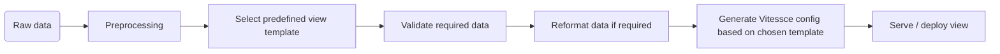
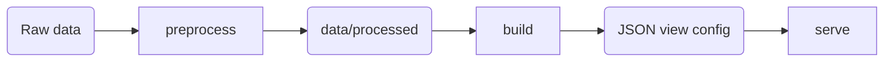

# Vitessce evaluation

The goal of this subfolder is to provide a minimal functional environment to
evaluate whether Vitessce is suitable to replace CellXGene for the CellXPatient
project.

The focus is on tool fit and deployment requirements. It is not intended to
implement the complete production workflow.

## Initial theoretical workflow

Proposed initial theoretical workflow from data preprocessing to view
visualization.



## Current prototype

The prototype is a small Python package ([src/vitessce_test](src/vitessce_test))
with a command-line interface in three steps:



Vitessce configurations are generated programmatically using the Python API in
[build.py](src/vitessce_test/build.py). To facilitate the creation of a Vitessce
view, the expected configuration is defined using a more human-readable YAML
template (see [example_template.yaml](example_template.yaml) or [template structure section](#template-structure)).


## Setup

Install the package in editable mode (`pip install -e .` or `uv sync`) and build
the frontend once:

```bash
cd frontend
npm install
npm run build
```

## Usage

Run `vitessce-test <command> --help` for all options.

### 1. Preprocess the data

Converts an AnnData (h5ad or zarr) or a Xenium dataset into a Vitessce-ready
zarr store in `data/processed`. The expression matrix is stored as a CSC sparse
matrix and the input is never modified. Existing outputs are only replaced with
the option `--overwrite`.

- AnnData (`.h5ad` or `.zarr`), optionally keeping only the cells where an obs
  column equals a value:

  ```bash
  vitessce-test preprocess --type anndata --input path/to/dataset.h5ad
  vitessce-test preprocess --type anndata --input path/to/dataset.h5ad --subset condition Healthy --output new_name
  ```

- Xenium output directory, with UMAP and clusters from the Xenium analysis files
  (default paths can be changed with `--umap` and `--clusters`):

  ```bash
  vitessce-test preprocess --type xenium --input path/to/xenium_output
  ```

Without `--output`, the output name is built from the input name
(`<input>_corrected.zarr`, or `<input>_<value>.zarr` for a subset). Use this
path, relative to `data/processed`, as `dataset_path` in the view template.

### 2. Build and serve a view

```bash
vitessce-test build --template path/to/dataset_template.yaml
```

The JSON config is written next to the template as `<name>_view.json`, and the
view is served at <http://127.0.0.1:8008>. Add `--build-only` to only write the
config.

### 3. Serve an existing config

```bash
vitessce-test serve --config path/to/dataset_view.json
```

Both `build` and `serve` accept `--port`. The server hosts the frontend, the
processed data and the config, so no separate data server is needed.

### Template Structure

The template contains three main sections:

- Datasets

  It defines the datasets used in the view and, when required, paths to specific
  elements within them. Default paths are used for standard AnnData and
  SpatialData structures, so the template only needs to specify paths that
  differ from these defaults. Defaults can be found in
  [datasets.py](src/vitessce_test/datasets.py).

- Views

  It defines which Vitessce views should be displayed, which datasets they refer
  to, and their position and size on a 12 × 12 grid.

- Coordination

  It defines how views interact and update together. This is the most tricky
  part of the Vitessce configuration.

  A coordination type represents a property that can be coordinated, such as
  featureSelection, obsSetSelection or obsColorEncoding. Not every view supports
  every coordination type and the coordination types have expected values
  depending on their definition; refer to the
  [Vitessce coordination documentation](https://vitessce.io/docs/coordination-types/#initial-coordination-values).

  For each coordination type, one or more coordination scopes can exist. Views
  referencing the same scope share the state of the corresponding coordination
  type:

  - view_1: coord_type_A -> scope_1
  - view_2: coord_type_A -> scope_1
  - view_3: coord_type_A -> scope_2

  Here, view_1 and view_2 are coordinated for coord_type_A, while view_3 is
  independent.

  Spatial views require additional hierarchical coordination for individual
  image and segmentation layers. The current prototype uses this to display the
  morphology image together with cell and nucleus boundaries, while linking the
  cell segmentation to selected gene expression.

## scRNA data example

To test the view coordination with Vitessce, we consider a theoretical scRNA
view template that compares gene expression between two conditions. The two
groups can be interactively defined via the sampleGroupBuilder plugin. This
plugin introduces a new view (GroupBuilder) that splits the data into two 
groups based on sample IDs, enabling comparison mode in several built-in 
Vitessce plots.

### Data source

The data used for the scRNA view template is the
[DUNLAP 2022 dataset](https://biohub.skinsciencefoundation.org/download/Dunlap_2022_all_final_label_transfer_swapped.h5ad)
on the
[Skin Science Foundation BioHub](https://biohub.skinsciencefoundation.org/filecrawl).

### Prototype view template

The view is generated using the
[corresponding YAML template](data/processed/dunlap_2022_comparison_template.yaml).
The following diagram shows in essence the plots layout and coordination space,
to facilitate the composition of the template.

<table>
  <tr>
    <th> x </th>
    <th>Grid 1-4</th>
    <th>Grid 5-8</th>
    <th>Grid 9-12</th>
  </tr>
  <tr>
    <td>Grid 1-4</td>
    <td>Group Builder</td>
    <td>Scatterplot</td>
    <td>Cell Sets</td>
  </tr>
  <tr>
    <td>Grid 5-7</td>
    <td colspan="2">Dot Plot</td>
    <td>Gene list</td>
  </tr>
  <tr>
    <td>Grid 8-10</td>
    <td>Violin plot</td>
    <td colspan="2">Heatmap</td>
  </tr>

</table>

## Spatial data example

To test the coordination between multi-layer spatial data and gene expression
data, we consider a theoretical spatial view template.

### Data source

The data used for the spatial view template is the Xenium 0OE1 example dataset
provided by Antonin Thiebault.

### Prototype view template

The view is generated using the
[corresponding YAML template](data/processed/xenium_0OE1_example_template.yaml).
The following diagram shows in essence the plots layout and coordination space,
to facilitate the composition of the template.

<table> 
  <tr> 
    <th>x</th> 
    <th>Grid 1-2</th> 
    <th>Grid 3-7</th> 
    <th>Grid 8-12</th> 
  </tr>
  <tr> 
    <td>Grid 1</td> 
    <td>Description</td> 
    <td rowspan="3">Spatial view (Scope A for cell/gene; Scope B for nucleus layer; Scope C for image layer)</td> 
    <td rowspan="3">Scatterplot UMAP (Scope A for cell/gene)</td> 
  </tr>
  <tr> 
    <td>Grid 2</td> 
    <td>Status</td> 
  </tr>
  <tr> 
    <td>Grid 3-6</td> 
    <td>Layer controller (Scopes A, B, C)</td> 
  </tr>
  <tr> 
    <td>Grid 7-9</td> 
    <td>Cell Sets (Scope A for cell)</td> 
    <td rowspan="2">Heatmap (Scope A for cell/gene)</td> 
    <td rowspan="2">Gene-linked Violin Plot (Scope A for cell/gene)</td> 
  </tr>
  <tr> 
    <td>Grid 10-12</td> 
    <td>Feature List (Scope A for gene)</td> 
  </tr>
</table>


## Notes:

The main documentation listing the available vitessce plots is not exhaustive. The source code and other sections of the documentation hint at 
more vitessce plots available, in particular that can be used to compare between sample pairs, e.g. Case vs Control.
Some notes about these undocumented plots:

- **sampleSetPairManager**: allows to select pairs of samples for which to compare data and coordinate the views at the sample level. The pairs have to be predefined and to follow a specific format referenced [here](https://vitessce.io/docs/data-comparative/). Three additional files have to be provided in the view config to use the sample-level coordination mechanism.
- **gating**: display a scatterplot that has gene-wise embeddings. X is for selected gene A expression and Y is for selected gene B expression
- **dotplot**: works with the sampleSet coorindation type, to display dot plots per selected gene and comparing between the selected pair of samples (case vs control)
- **featureStatsTable** volcanoPlot, obsSetCompositionBarPlot, treemap: these need precomputed differential expression results.


### Sample-level comparison

Some Vitessce plots can compare two groups side by side (e.g. one violin per group) using sample-leve coordination types:
- sampleType: links views to the sample data
- sampleSetSelection: the compared pair
- sampleSetFilter: restricts views to the selected groups

To map cells id to the appropriate group, additional files need to be prepared and provided to the view config ([File type documentation](https://vitessce.io/docs/data-file-types/)):

- sampleSets.csv: one row per sample, one column per category (e.g. Disease) defines the sample groups (necessary for the built-in **sampleSetPairManager** view and the **groupBuilder** plugin view)
- sampleEdges.anndata.zarr: which column of the AnnData obs table that maps the cells to the sample category (only for the built-in **sampleSetPairManager** view)
- comparisonMetadata.anndata.zarr: unstructured metadata to store the comparison information (only for the built-in **sampleSetPairManager** view)

Necessary files are generated by `build.py` if the sample_comparison block of a dataset is referenced in the YAML template, see [the example YAML template](example_template.yaml).
